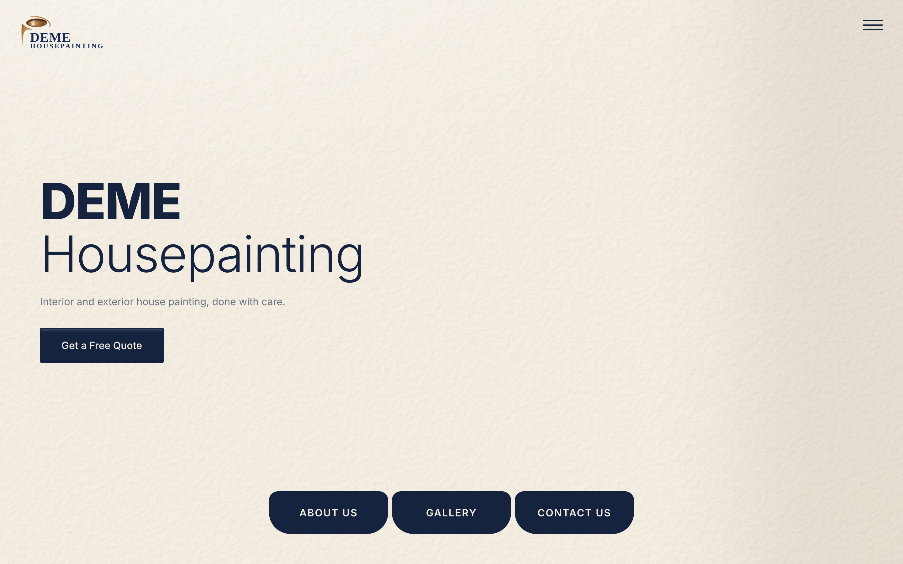

# DEME Housepainting

Website and contact form for **DEME Housepainting**, a family-run interior and exterior painting business run by Zoltan and his son Ben.

**[Live site](https://deme-housepainting.vercel.app)** · **[Portfolio](https://cianmccaul.vercel.app)**



## What it does

- **Before and after gallery.** On desktop you drag a paintbrush across each photo to reveal the finished job. On phones it switches to a touch-friendly layout.
- **Feature wall video.** A short start-to-finish clip of a real job, with a poster image so the page loads fast.
- **Contact form that emails the business.** Submissions go to a small serverless function (`api/contact.js`) that validates the input and sends a formatted email through Resend. The API key stays on the server and never reaches the browser.
- **Built for phones.** A dedicated phone nav bar, responsive layouts and app icons, so it can be saved to a home screen.
- **Readable by AI search.** An `llms.txt` file describes the business for AI assistants and search tools.

## How it works

A single static page with no build step. The only server code is one Vercel function for the contact form: `js/scroll.js` posts the form to `/api/contact`, which checks the input (name and contact required, length limits) and sends the enquiry through Resend's API, with the key read from an environment variable.

```
index.html        the single-page site
privacy.html      privacy notice for the contact form
css/              styles, split by section (landing, gallery, about, contact, ...)
js/gallery.js     before/after paintbrush slider
js/scroll.js      scroll behaviour and the contact form
api/contact.js    serverless function that sends the enquiry email
assets/           photos, video and logo
```

## Run it locally

It's a static site, so any local server works:

```
npx serve .
```

The contact form needs the Vercel function plus two environment variables: `RESEND_API_KEY` and `CONTACT_EMAIL_TO` (where enquiries are sent). Run `vercel dev` with the key set to test it end to end.

## Tests

There are no automated tests yet.

## Built with

- HTML, CSS and vanilla JavaScript, with no framework, so the page stays fast
- Vercel for hosting and the serverless contact function
- Resend for email

---

Designed and built by [Cian McCaul](https://github.com/cianmccaul).
